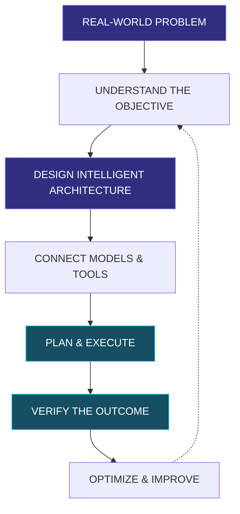

 

 

  

**I DON'T JUST BUILD CHATBOTS. I ENGINEER INTELLIGENT SYSTEMS.**

*Building the next generation of autonomous agents, AI-powered software and intelligent automation.*

 

 

---

# ◈ THE ENGINEERING IDENTITY

### Three disciplines. One engineering vision.

<table>
<tr>
<td width="33%" align="center" valign="top">

### ◉ AGENTIC AI

Autonomous Intelligence

- AI Agents
- Multi-Agent Systems
- Agent Orchestration
- Tool Calling
- Reasoning & Planning
- Agent Memory
- Autonomous Execution

</td>
<td width="33%" align="center" valign="top">

### ◈ AI ENGINEERING

Intelligent Architecture

- LLM Engineering
- RAG Systems
- Model Routing
- Context Engineering
- AI Evaluation
- Backend Architecture
- Production AI Systems

</td>
<td width="33%" align="center" valign="top">

### ⌘ AI AUTOMATION

Intelligent Operations

- Workflow Engineering
- Business Automation
- API Integrations
- AI Customer Support
- Event-Driven Systems
- Process Automation
- Autonomous Workflows

</td>
</tr>
</table>

---

## 01 / ABOUT THE ENGINEER

I'm **Ahmed Ansari**, an AI-focused developer interested in engineering intelligent systems that go beyond conventional software interactions.

My work revolves around combining AI models, autonomous agents, software engineering, APIs, databases and workflow orchestration to solve real-world problems.

I focus on building systems that can:

- Understand objectives and break them into actionable tasks.
- Reason, plan and interact with external tools.
- Execute intelligent workflows with appropriate human oversight.
- Connect AI capabilities with real business operations.
- Maintain context, evaluate results and improve execution.
- Transform repetitive processes into reliable automated systems.

**My philosophy:**

> Intelligence is valuable when it can do something meaningful. I focus on engineering AI that doesn't just respond — it actually helps get things done.

---

## 02 / WHAT I ENGINEER

<b>◉ AGENTIC AI SYSTEMS</b>

- Autonomous task execution architectures.
- Multi-agent collaboration and orchestration.
- Dynamic tool creation and execution.
- Agent planning and reasoning.
- Persistent memory and context management.
- Human-in-the-loop approval mechanisms.
- Sandboxed execution environments.
- Task verification and recovery.

<b>◈ AI ENGINEERING & ARCHITECTURE</b>

- LLM-powered applications.
- Retrieval-Augmented Generation.
- Context engineering.
- Model selection and routing.
- AI backend and API development.
- Intelligent knowledge systems.
- AI evaluation and reliability.
- Local-first and hybrid AI architectures.

<b>⌘ AI AUTOMATION & WORKFLOW ENGINEERING</b>

- Intelligent business process automation.
- AI-powered customer support.
- WhatsApp and communication automation.
- API-based integrations.
- Event-driven workflow architectures.
- Automated lead generation workflows.
- E-commerce operations automation.
- Human approval and exception handling.

---

## 03 / TECHNOLOGY ECOSYSTEM

### AI & LLM ENGINEERING

### AUTOMATION & ORCHESTRATION

### DEVELOPMENT & FRAMEWORKS

### DATABASES & INFRASTRUCTURE

---

## 04 / SELECTED ENGINEERING PROJECTS

*Ideas engineered into real software systems.*

<table>
<tr>
<td width="50%" valign="top">

### ◈ OmniFlow

**AI-Powered Business Automation Platform**

An ambitious platform bringing intelligent agents, customer communication and business workflow orchestration into one ecosystem.

**Engineering focus**

- Business-specific AI agents.
- Intelligent customer interactions.
- Multi-channel communication.
- Workflow orchestration.
- Flask-based control plane.
- Scalable automation infrastructure.

<a href="https://github.com/AHMEDANSARI0/Omniflow">↗ EXPLORE PROJECT</a>

</td>
<td width="50%" valign="top">

### ◉ Omni-Assistant

**Local-First Hybrid AI Assistant**

An intelligent assistant architecture focused on natural-language task execution and autonomous tool orchestration.

**Engineering focus**

- Natural-language task execution.
- Dynamic tool creation.
- Persistent memory.
- Sandboxed execution.
- Local and hybrid AI.
- Human approval mechanisms.
- Verification and recovery.

<a href="https://github.com/AHMEDANSARI0/Omni-Assistant">↗ EXPLORE PROJECT</a>

</td>
</tr>
<tr>
<td width="50%" valign="top">

### ⌘ Nabat

**E-Commerce & Digital Commerce Platform**

A private-label commerce project focused on a modern storefront and database-driven business management.

**Engineering focus**

- Next.js application architecture.
- Product and order management.
- Database-driven administration.
- E-commerce operations.
- Scalable application structure.

<a href="https://github.com/AHMEDANSARI0/e-com">↗ EXPLORE PROJECT</a>

</td>
<td width="50%" valign="top">

### ◇ EXPLORE MORE

**Research, Experiments & Engineering**

Explore my repositories for additional experiments, integrations, software engineering and AI development.

- AI experiments.
- Backend development.
- Automation workflows.
- API integrations.
- Intelligent applications.

<a href="https://github.com/AHMEDANSARI0?tab=repositories">↗ ALL REPOSITORIES</a>

</td>
</tr>
</table>

Project descriptions represent their engineering goals and focus areas; features may still be under active development.

---

## 05 / HOW I THINK ABOUT ENGINEERING

My engineering principles:

| Principle | Philosophy |
|---|---|
| Intelligence | Use AI where it creates real value. |
| Autonomy | Let systems accomplish meaningful tasks. |
| Reliability | Verify execution and outcomes. |
| Security | Make safety part of the architecture. |
| Control | Keep sensitive actions appropriately supervised. |
| Efficiency | Build performant, maintainable systems. |

---

## 06 / CURRENT EXPLORATION

Currently interested in pushing the boundaries of:

- Advanced Agentic AI architectures.
- Multi-agent collaboration.
- Autonomous software engineering.
- Long-term agent memory.
- LLM orchestration and model routing.
- AI-powered business operations.
- Reliable tool-use and execution.
- Local-first and hybrid AI infrastructure.

---

## 07 / GITHUB ANALYTICS

  

  

---

## 08 / CONNECT WITH ME

### LET'S BUILD SOMETHING INTELLIGENT.

Open to meaningful conversations, engineering collaborations, AI projects and opportunities involving intelligent automation.

 

  

**PORTFOLIO:** https://ahmedansari.vercel.app

**GITHUB:** https://github.com/AHMEDANSARI0

 

### THINK BEYOND CHATBOTS.

### ENGINEER INTELLIGENCE. BUILD AUTONOMY. AUTOMATE WHAT MATTERS.

 

