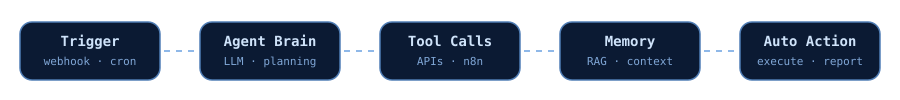

  

  
  
  
  
  

<h2 align="center"> <i>Technologies</i></h2>

  
  
  
  
  
   
  
  
  
  
  
  
   
  
  
  
  
  
  
  

<h2 align="center"> <i>About Me</i></h2>

<table align="center">
<tr>
<td width="35%" align="center">
  
</td>
<td width="65%" align="center">

Hello! My name is **Ahmed Ansari**, and I am an **AI Automation Engineer** & Full-Stack Developer. I am passionate about making AI do more than generate text: building agents, connecting intelligent systems with real-world tools, and automating work that normally takes hours. Currently, I am honing my skills in **Agentic AI, LLM workflows, Python and TypeScript**, focusing on building robust, autonomous systems and continuously growing within the AI industry.

</td>
</tr>
</table>

<h2 align="center"> <i>How My Agents Work</i></h2>

<h2 align="center"> <i>Things I'm Building</i></h2>

<table align="center">
<tr>
<td align="center" width="33%"><b><a href="https://github.com/AHMEDANSARI0/Omniflow">OmniFlow</a></b> AI-powered business automation and intelligent customer interaction.</td>
<td align="center" width="33%"><b><a href="https://github.com/AHMEDANSARI0/Omni-Assistant">Omni-Assistant</a></b> A local-first AI assistant that understands, plans and executes tasks.</td>
<td align="center" width="33%"><b><a href="https://github.com/AHMEDANSARI0/e-com">Nabat</a></b> A modern e-commerce experience with a database-driven backend.</td>
</tr>
</table>

<h2 align="center"> <i>Hobbies & Goals</i></h2>

<table align="center">
<tr>
<td align="center" width="70%">

AI Automation Engineer & Full-Stack Developer. 
_"Less hype. More engineering. Better automation."_ — **Ahmed Ansari**.

 **Main Focus:** Agentic AI · Workflows · Automation

</td>
<td align="center" width="30%"></td>
</tr>
</table>

